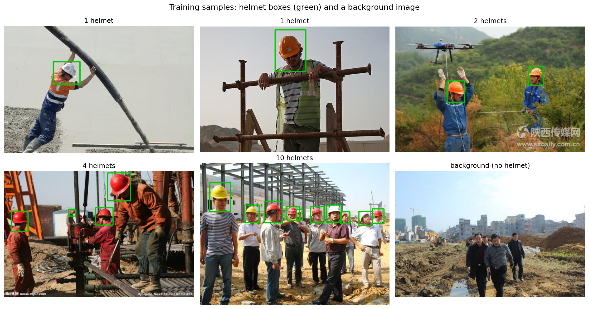
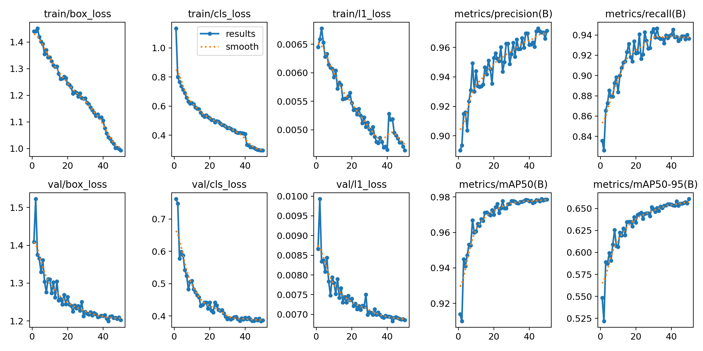
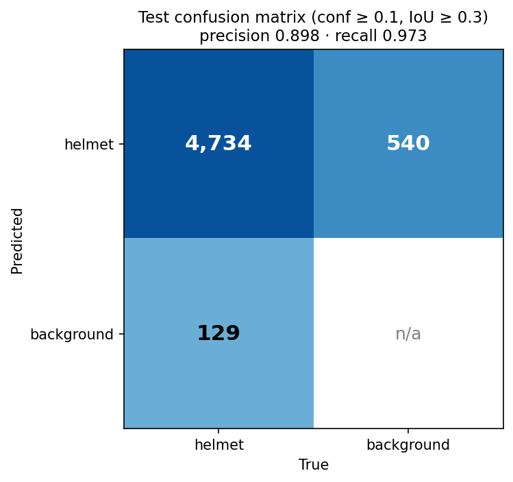
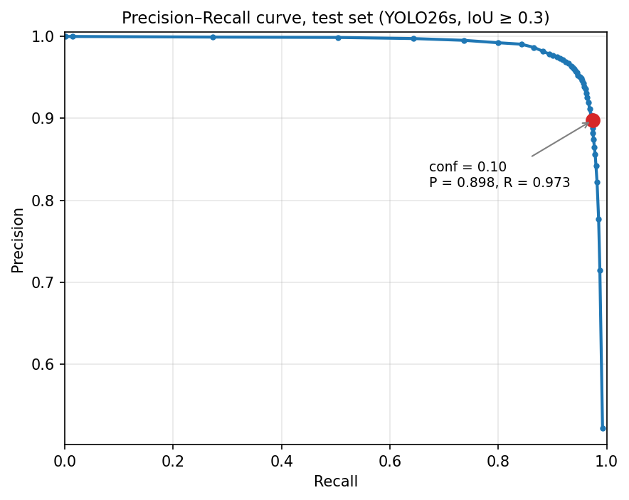
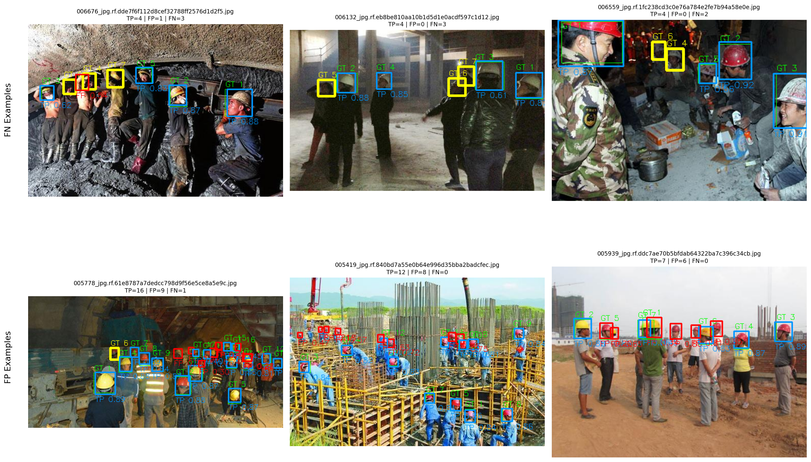

# 🦺 Helmet Detection with YOLO26

> **Computer Vision • Object Detection • Dataset Quality • Error
> Analysis • Model Evaluation**

<p align="center">


</p>

------------------------------------------------------------------------

## ⭐ Project Highlights

A single-class object-detection project that detects safety helmets in
construction-site images. The workflow focuses not only on model
training, but also on dataset quality, annotation correction, fair model
comparison, confidence-threshold selection, and error analysis.

- 🦺 **Task:** single-class helmet detection
- 🧠 **Final model:** YOLO26s, fine-tuned from pretrained weights
- 📊 **Test performance:** mAP@50 **0.978**, mAP@50–95 **0.676**
- 🔍 **Dataset quality:** exact- and near-duplicate checks before
  creating the validation split
- 🏷️ **Annotation review:** missing validation labels identified with
  FiftyOne and corrected in CVAT
- 🧪 **Experiments:** YOLO26n baseline, fine-tuning, custom
  augmentation, YOLO26s, and test-time augmentation (TTA)
- 🧩 **Error analysis:** false positives, false negatives, confidence
  thresholds, and incomplete annotations
<p align="center">
  
  <br><em>Sample YOLO26s predictions on held-out test images.</em>
</p>
## 📌 Project Workflow

``` text
Dataset Inspection
       ↓
Class Filtering & Label Validation
       ↓
Duplicate Detection
       ↓
Leakage-Safe Train / Validation Split
       ↓
Annotation Review (FiftyOne + CVAT)
       ↓
YOLO26n Baseline → Fine-Tuning → Custom Augmentation
       ↓
YOLO26s Model Comparison
       ↓
Threshold Selection & Test-Time Augmentation
       ↓
False Positive / False Negative Analysis
```

## 🗂️ Dataset

The project uses the public [Hard Hat Workers
dataset](https://universe.roboflow.com/joseph-nelson/hard-hat-workers),
version `v2 raw_75-25_trainTestSplit`. The dataset was provided by
Northeastern University – China and is available through [Harvard
Dataverse](https://dataverse.harvard.edu/dataset.xhtml?persistentId=doi:10.7910/DVN/7CBGOS).
The listed license is Public Domain.

### Original dataset

| Item                     |                    Details |
|--------------------------|---------------------------:|
| Training images          |                      5,269 |
| Test images              |                      1,766 |
| Original classes         | `head`, `helmet`, `person` |
| Original annotated boxes |                     27,039 |

Only the `helmet` class was retained and remapped to class `0`. The
`head` and `person` annotations were excluded because manual inspection
found them incomplete for reliable single-class detection.

After filtering, the original training split contained 14,884 helmet
boxes and the test split contained 4,863. Images that had only `head` or
`person` labels were retained as background images.

### Data analysis

- Checked label coordinates and box dimensions for validity.
- Examined class combinations and object-size distribution.
- Approximately **91% of the original boxes cover less than 5% of the
  image area**, making small-object detection an important
 <p align="center">
  
  <br><em>Sample YOLO26s predictions on held-out test images.</em>
 </p>
  characteristic of this dataset.
- Checked exact duplicates using MD5 and near-duplicates using
  perceptual hashing (pHash).

### Leakage-safe validation split

The original dataset did not include a validation set. To reduce
near-duplicate leakage:

1.  No exact duplicate images were found using MD5.
2.  pHash pairs with Hamming distance ≤ 5 were grouped into connected
    components.
3.  Near-duplicate groups were kept together when splitting.
4.  The resulting split contains 4,215 training images and 1,054
    validation images, with no train/validation overlap or split
    duplicate groups.

| Split                                | Images |
|--------------------------------------|-------:|
| Train                                |  4,215 |
| Validation                           |  1,054 |
| Test (original split, kept separate) |  1,766 |

## 🏷️ Annotation Correction

Missing helmet annotations can make a correct detection appear to be a
false positive and can distort evaluation. The validation labels were
reviewed through a model-assisted workflow:

1.  Loaded images, labels, and model predictions into **FiftyOne**.
2.  Inspected suspicious samples, including high-confidence false
    positives.
3.  Sent selected validation images to **CVAT** to add missing helmet
    boxes.
4.  Merged the corrected annotations and exported them in YOLO format.
5.  Revisited additional missed helmets after the first error-analysis
    pass.

| Validation-label stage       | Helmet boxes |
|------------------------------|-------------:|
| Original labels              |        2,920 |
| After first correction round |        2,992 |
| After second manual pass     |        3,008 |

Only validation labels were corrected; training and test labels were
left unchanged. Since validation corrections were guided partly by model
errors, validation results may be somewhat optimistic. The test set was
kept untouched, although its original labels also contain some missing
helmets.

## 🧠 Models and Training

All runs used `imgsz=640`, `batch=8`, a single GPU, and the Ultralytics
training pipeline.

| Run          | Model   | Initialization               | Epochs | Notes                                       |
|--------------|---------|------------------------------|-------:|---------------------------------------------|
| `n_baseline` | YOLO26n | Pretrained YOLO26n           |     50 | Initial baseline                            |
| `n_fixed`    | YOLO26n | `n_baseline` best checkpoint |     30 | Fine-tuned with corrected validation labels |
| `n_aug`      | YOLO26n | `n_fixed` best checkpoint    |     30 | Added custom Albumentations transforms      |
| `s`          | YOLO26s | Pretrained YOLO26s           |     50 | No custom augmentation                      |

### Model size

| Model   | Parameters | GFLOPs |
|---------|-----------:|-------:|
| YOLO26n |     2.38 M |    5.3 |
| YOLO26s |     9.47 M |   20.8 |

### Custom augmentation experiment

The custom Albumentations pipeline was designed to test whether lighting
changes, glare, shadows, occlusion, and blur could address observed
failure cases. These transforms were applied alongside the default
Ultralytics training augmentations.

| Transform                      | Settings                                    | Probability |
|--------------------------------|---------------------------------------------|------------:|
| `RandomBrightnessContrast`     | Brightness ±0.3, contrast ±0.3              |         0.5 |
| `CLAHE`                        | Clip limit 4.0                              |         0.3 |
| `RandomSunFlare`               | 3–6 flare circles, source radius 40         |         0.4 |
| `RandomShadow`                 | Default settings                            |         0.2 |
| `CoarseDropout`                | 1–4 holes; each 5–15% of image height/width |         0.3 |
| `MotionBlur` or `GaussianBlur` | Blur limit 7, selected through `OneOf`      |         0.2 |
<p align="center">
  
  <br><em>Sample YOLO26s predictions on held-out test images.</em>
 </p>
The YOLO26n experiments were sequential fine-tuning runs: `n_fixed`
continued from `n_baseline`, and `n_aug` continued from `n_fixed`.
Therefore, they do not represent independent runs with identical
training histories.

## 📊 Results

### Validation set

All models below were evaluated on the same corrected validation labels:
1,054 images and 3,008 helmet boxes.

| Model                                   | Precision |    Recall |    mAP@50 | mAP@50–95 |
|-----------------------------------------|----------:|----------:|----------:|----------:|
| YOLO26n baseline                        |     0.962 |     0.925 |     0.973 |     0.649 |
| YOLO26n fine-tuned (`n_fixed`)          |     0.960 |     0.934 |     0.968 |     0.649 |
| YOLO26n + custom augmentation (`n_aug`) |     0.960 |     0.932 |     0.974 |     0.649 |
| **YOLO26s**                             | **0.971** | **0.936** | **0.979** | **0.661** |

**Main observations**

- YOLO26s achieved the strongest overall validation results,
  particularly in precision and mAP.
- Custom augmentation did not produce a measurable improvement in
  mAP@50–95 for YOLO26n.
- Fine-tuning and augmentation changed the precision/recall balance, but
  the differences between YOLO26n variants are small and should not be
  overinterpreted from a single run.
- On the original, uncorrected validation labels, the baseline had
  mAP@50–95 of 0.668. Scores on corrected labels are not directly
  comparable with scores on the original labels because 88 additional
  ground-truth boxes were added.

### Held-out test set — YOLO26s

The test set contains 1,766 images and 4,863 annotated helmets. These
metrics are from standard single-pass inference without TTA.

| Precision | Recall | mAP@50 | mAP@50–95 |
|----------:|-------:|-------:|----------:|
|     0.957 |  0.945 |  0.978 |     0.676 |

At a fixed confidence threshold of `0.1` and matching IoU of `0.3`, the
separate error-analysis pipeline produced:

|    TP |  FP |  FN | Precision | Recall |
|------:|----:|----:|----------:|-------:|
| 4,734 | 540 | 129 |     0.898 |  0.974 |
<p align="center">
  
  <br><em>Sample YOLO26s predictions on held-out test images.</em>
 </p>
 <p align="center">
  
  <br><em>Sample YOLO26s predictions on held-out test images.</em>
 </p>
Ultralytics’ reported precision and recall use its own selected
operating point, so those values differ from the fixed-threshold
error-analysis values above.

Approximately 139 of the 540 test false positives were manually
identified as real helmets missing from the original test annotations.
This indicates that incomplete ground truth affects the measured
precision; the estimate should be treated as a manual review, not as a
replacement for a fully corrected test set.

## 🎚️ Confidence Threshold Analysis

The following table uses corrected validation labels and matching IoU
`0.3`. Changing the confidence threshold trades off missed helmets (FN)
against false detections (FP).

| Confidence | Model         | Precision | Recall |  FN |  FP |
|-----------:|---------------|----------:|-------:|----:|----:|
|       0.05 | YOLO26n + aug |     0.922 |  0.970 |  89 | 247 |
|       0.05 | YOLO26n       |     0.917 |  0.970 |  90 | 264 |
|       0.05 | YOLO26s       |     0.927 |  0.973 |  80 | 232 |
|       0.10 | YOLO26n + aug |     0.942 |  0.962 | 113 | 179 |
|       0.10 | YOLO26n       |     0.942 |  0.964 | 107 | 180 |
|       0.10 | YOLO26s       |     0.949 |  0.965 | 104 | 156 |
|       0.15 | YOLO26n + aug |     0.952 |  0.957 | 129 | 144 |
|       0.15 | YOLO26n       |     0.953 |  0.959 | 124 | 142 |
|       0.15 | YOLO26s       |     0.959 |  0.959 | 122 | 122 |
|       0.25 | YOLO26n + aug |     0.965 |  0.948 | 156 | 102 |
|       0.25 | YOLO26n       |     0.965 |  0.951 | 146 | 105 |
|       0.25 | YOLO26s       |     0.971 |  0.949 | 153 |  84 |

**Interpretation**

- YOLO26s has fewer total errors (FN + FP) than the YOLO26n variants at
  each tested threshold.
- The tested custom augmentation does not consistently reduce FN and FP
  together compared with plain YOLO26n.
- A lower confidence threshold recovers more helmets but also admits
  more false positives. The operating threshold should depend on the
  application’s tolerance for missed helmets versus false alarms.

## 🔄 Test-Time Augmentation (TTA)

TTA was evaluated on YOLO26s by predicting multiple views of each
validation image, mapping predictions back to the original coordinates,
and fusing boxes with **Weighted Boxes Fusion**. The fusion settings
were `iou_thr=0.55`, `skip_box_thr=0.001`, and confidence type `avg`;
each view was predicted at `conf=0.001`.

Total errors are defined as `FN + FP`; lower is better.

| Configuration                       | conf 0.05 | conf 0.10 | conf 0.15 | conf 0.25 |
|-------------------------------------|----------:|----------:|----------:|----------:|
| No TTA                              |       312 |       260 |       244 |       237 |
| Original + flip                     |       299 |       242 |   **219** |       235 |
| Original + flip + 2 spotlight views |       308 |       260 |       236 |       234 |
| Original + flip + brighter + darker |       314 |       254 |       226 |       228 |

The best tested configuration was **original + flip at `conf=0.15`**: FN
remained at 122 while FP decreased from 122 to 97, increasing precision
from 0.959 to 0.967. This is a modest reduction in total errors, with at
least twice the inference work. The tested lighting views did not
improve on the original-plus-flip configuration.

## 🔍 Error Analysis

### False negatives

For a more detailed diagnosis, missed ground-truth boxes were
re-examined with a second prediction pass at a low confidence threshold.
This helps distinguish detections that are present but scored too low
from failures involving localization.
<p align="center">
  
  <br><em>Sample YOLO26s predictions on held-out test images.</em>
</p>
For the YOLO26n + augmentation analysis at `conf=0.25`, using IoU ≥ 0.5
for this per-object classification:

| Failure type                            | Definition                                                                        |   Count |    Share |
|-----------------------------------------|-----------------------------------------------------------------------------------|--------:|---------:|
| Low confidence                          | A prediction overlaps the ground truth at IoU ≥ 0.5, but confidence is below 0.25 |     110 |    67.9% |
| Low confidence + localization           | Prediction has low confidence and insufficient overlap                            |      39 |    24.1% |
| Localization                            | Prediction is confident but IoU is below 0.5                                      |      13 |     8.0% |
| **Total missed boxes in this analysis** |                                                                                   | **162** | **100%** |

These per-object categories use an IoU criterion of `0.5`, while the
threshold table above uses matching IoU `0.3`; therefore, their FN
counts are not expected to match exactly.

Visual review found challenging conditions including strong
illumination, reflections, partial visibility, and crowded scenes.
Lowering the confidence threshold recovers some low-confidence
detections, but it also increases false positives.

### False positives

The main observed sources were visually similar non-helmet objects and
incomplete ground-truth annotations, including real helmets near image
boundaries that were not labeled. Consequently, not every box counted as
an FP necessarily represents a genuinely incorrect detection.

## 🧰 Technologies

- **Language:** Python
- **Detection model:** Ultralytics YOLO26n / YOLO26s
- **Deep learning:** PyTorch
- **Dataset and error inspection:** FiftyOne
- **Annotation correction:** CVAT
- **Augmentation:** Albumentations
- **Evaluation and visualization:** Supervision
- **Box fusion for TTA:** Weighted Boxes Fusion (`ensemble-boxes`)
- **Environment:** Jupyter Notebook, VS Code, CUDA

## ⚠️ Limitations and Next Steps

- Each model configuration was evaluated from a single training run;
  small differences between YOLO26n variants may be due to run-to-run
  variation.
- The YOLO26n experiments are sequential fine-tunes and do not have
  identical training histories.
- Validation annotations were corrected with model-assisted review,
  which can make validation results optimistic.
- Test annotations were not corrected; measured test precision is
  affected by missing ground-truth boxes.
- The project detects helmets only. Detecting people without helmets
  would require reliable annotations for people or heads.
- Useful future work includes completing test annotations, repeating
  experiments with multiple seeds, and testing higher input resolution
  for small helmets.

## ♻️ Reproducibility

**Environment used:** Python 3.10.19, PyTorch 2.5.1 (CUDA 12.1),
Ultralytics 8.4.138, NVIDIA GeForce RTX 3050 Ti Laptop GPU (4 GB).

The dataset and trained weights are not embedded in this README. Update
the checkpoint path below to point to your local or published weights.

``` python
from ultralytics import YOLO

model = YOLO("path/to/best.pt")
results = model.predict("path/to/image.jpg", imgsz=640, conf=0.1)
```

## 📚 Credits

- **Dataset:** [Hard Hat
  Workers](https://universe.roboflow.com/joseph-nelson/hard-hat-workers),
  provided by Northeastern University – China via [Harvard
  Dataverse](https://dataverse.harvard.edu/dataset.xhtml?persistentId=doi:10.7910/DVN/7CBGOS);
  Public Domain.
- **Ultralytics YOLO:**
  [GitHub](https://github.com/ultralytics/ultralytics)
- **FiftyOne:** [Website](https://voxel51.com/fiftyone/)
- **CVAT:** [Website](https://www.cvat.ai/)
- **Albumentations:** [Website](https://albumentations.ai/)
- **Supervision:** [GitHub](https://github.com/roboflow/supervision)
- **Weighted Boxes Fusion:**
  [ensemble-boxes](https://github.com/ZFTurbo/Weighted-Boxes-Fusion)
- **Author:** Ziba Hatamian — [GitHub](https://github.com/zziibbaa)

------------------------------------------------------------------------

⭐ If you find this project useful, consider giving the repository a
star.
